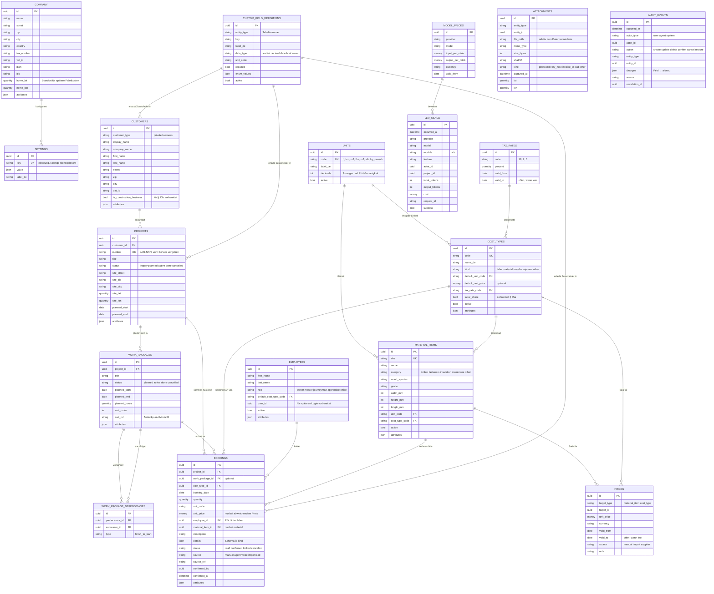

# Datenmodell TimberTalk Core

Stand: Block 1 (Datenmodell, Datenbank, Service-Schicht, REST-API).

Dieses Dokument erklärt, wie die Daten zusammenhängen und – wichtiger – **wie man das Modell
erweitert, ohne Code zu ändern**. Die beiden häufigsten Fälle, eine neue Kostenart und ein
neues Zusatzfeld, stehen unten in Abschnitt 5 und 6.

## 1. Überblick



## 2. Regeln, die für jede Tabelle gelten

| Spalte | Bedeutung |
| --- | --- |
| `id` | UUID der Version 7, also zeitlich sortierbar. Keine laufenden Zahlen. |
| `created_at`, `updated_at` | zeitzonenbewusst in UTC. Der Typ `UtcDateTime` verhindert, dass naive Zeitstempel in die Anwendung gelangen. |
| `deleted_at` | Soft Delete. Gelöschte Datensätze bleiben für die Synchronisation mit der späteren App erhalten. |
| `version` | optimistisches Sperren. Wer ändert, kann `expected_version` mitgeben; bei Abweichung gibt es `409 Konflikt`. |

**Eindeutigkeit mit Soft Delete:** Codes und Schlüssel liegen in eindeutigen *Teilindizes*
`WHERE deleted_at IS NULL`. Eine gelöschte Einheit blockiert ihr Kurzzeichen also nicht.
Eine Ausnahme ist die Projektnummer: der Zähler überspringt vergebene Nummern auch dann,
wenn das Projekt gelöscht wurde, damit keine Nummer zweimal auf einem Beleg erscheint.

**Geld und Mengen** sind immer `Decimal`, niemals `float`. In der Datenbank sorgen die
eigenen Typen `Money` und `Quantity` dafür, dass Werte auf SQLite als Text zeichengenau
und auf Postgres als `NUMERIC(18,6)` liegen. `Decimal("489.5000")` kommt als
`Decimal("489.5000")` zurück, inklusive Nachkommastellen. Gleitkommazahlen werden
abgelehnt, nicht gerundet.

**Enums** sind Zeichenketten in der Datenbank und werden in Pydantic geprüft. Das hält
Migrationen einfach: eine neue Statusstufe braucht keine Schemaänderung.

## 3. Status einer Buchung

```
          ┌──────────────── storniert ────────────────┐
          │                                           ▼
draft ──(nur ein Mensch bestätigt)──▶ confirmed ──▶ cancelled
          │                               │
          │                               └──(spätere Rechnung)──▶ locked
          └──────────────── storniert ────────────────▲
```

- Jede neue Buchung beginnt als `draft`. Für Einträge aus KI, Sprache, Import oder CAD
  verlangt der Auftrag das ausdrücklich; für Einträge von Hand gilt es ebenso, damit das
  Bestätigen immer ein eigener, menschlicher Schritt bleibt.
- `confirm` ist nur mit Akteur-Typ `user` erlaubt. Ein Agent erhält `403`.
- `locked` setzt erst die Rechnung (Block 3). `locked`-Buchungen lassen sich weder ändern
  noch stornieren noch löschen.
- `cancelled` ist unveränderbar und lässt sich auch nicht löschen; die Stornierung bleibt
  nachvollziehbar.

## 4. Preisermittlung

`get_price(target, on_date)` sucht in dieser Reihenfolge und nennt im Ergebnis die Herkunft:

1. ein gültiger Eintrag in `prices` für das Ziel selbst → `price_material_item`
2. bei einem Artikel: ein gültiger Eintrag für seine Kostenart → `price_cost_type`
3. `cost_types.default_unit_price` → `cost_type_default`

Bei einer Buchung geht ein dort eingetragener `unit_price` allen vor (Herkunft `booking`).
Überlappende Gültigkeiten für dasselbe Ziel sind ein Fehler; ein leeres `valid_to` bedeutet
„gilt weiter". Buchungen speichern **keine** Summen: Betrag und geltender Preis werden beim
Lesen ermittelt. Die Rechnung in Block 3 kopiert sie dann als Schnappschuss.

## 5. Eine neue Kostenart hinzufügen (ohne Code)

Beispiel: Gerüstmiete, abgerechnet nach Tagen.

**Über die API:**

```bash
# 1. Falls die Einheit fehlt, zuerst die Einheit anlegen
curl -X POST http://localhost:8000/units \
  -H "X-API-Key: $TIMBERTALK_API_KEY" -H "X-Actor-Type: user" \
  -H "Content-Type: application/json" \
  -d '{"code": "tag", "label_de": "Tag", "decimals": 2, "sort_order": 85}'

# 2. Kostenart als Datensatz anlegen
curl -X POST http://localhost:8000/cost-types \
  -H "X-API-Key: $TIMBERTALK_API_KEY" -H "X-Actor-Type: user" \
  -H "Content-Type: application/json" \
  -d '{
        "code": "scaffolding",
        "name_de": "Gerüst",
        "kind": "equipment",
        "default_unit_code": "tag",
        "default_unit_price": "120.0000",
        "tax_rate_code": "19",
        "labor_share": false,
        "sort_order": 85
      }'

# 3. Sofort buchbar – ohne Neustart, ohne Code-Änderung
curl -X POST http://localhost:8000/bookings \
  -H "X-API-Key: $TIMBERTALK_API_KEY" -H "X-Actor-Type: user" \
  -H "Content-Type: application/json" \
  -d '{
        "project_id": "<Projekt-UUID>",
        "cost_type_id": "<Kostenart-UUID>",
        "booking_date": "2026-05-20",
        "quantity": "3.00",
        "details": {"equipment_name": "Fassadengerüst 120 m²", "hours_or_days": "3"}
      }'
```

`kind` bestimmt dabei das Verhalten und ist die einzige feste Liste:

| `kind` | Bedeutung | Pflichtfelder in `details` |
| --- | --- | --- |
| `labor` | Arbeitszeit | keine; `employee_id` ist Pflicht an der Buchung |
| `material` | Material | keine |
| `travel` | Fahrt | keine |
| `equipment` | Geräte, Kran, Gerüst | `equipment_name` |
| `other` | Pauschalen, Entsorgung | keine |

**Wann ist doch Code nötig?** Nur, wenn eine Kostenart *eigene Detailfelder* braucht, die
keines der fünf `kind` abdeckt. Dann kommen in `domain/bookings/details.py` ein
Pydantic-Schema und eine Zeile `register_details(...)` hinzu – Tabelle und Service bleiben
unverändert. Prozentuale Zuschläge sind bewusst noch nicht gebaut, das Modell verbaut sie
aber nicht.

## 6. Ein neues Zusatzfeld hinzufügen (ohne Code)

Beispiel: Woher kennt ein Kunde den Betrieb?

```bash
curl -X POST http://localhost:8000/custom-fields \
  -H "X-API-Key: $TIMBERTALK_API_KEY" -H "X-Actor-Type: user" \
  -H "Content-Type: application/json" \
  -d '{
        "entity_type": "customers",
        "key": "referral_source",
        "label_de": "Wie hat der Kunde uns gefunden?",
        "data_type": "enum",
        "enum_values": ["empfehlung", "internet", "messe", "stammkunde"],
        "required": false
      }'
```

Danach ist das Feld in `customers.attributes` erlaubt und wird geprüft:

```bash
curl -X POST http://localhost:8000/customers \
  -H "X-API-Key: $TIMBERTALK_API_KEY" -H "X-Actor-Type: user" \
  -H "Content-Type: application/json" \
  -d '{"customer_type": "private", "first_name": "Eva", "last_name": "Reich",
       "attributes": {"referral_source": "messe"}}'
```

Regeln der Prüfung:

- **Unbekannte Schlüssel werden abgelehnt.** Ein Tippfehler landet nicht stillschweigend
  in der Datenbank.
- Pflichtfelder (`required`) müssen gesetzt sein.
- Werte werden auf den `data_type` geprüft und JSON-tauglich normalisiert: `decimal` und
  `date` werden als Zeichenkette gespeichert, damit nichts verloren geht
  (`"12.50"`, `"2026-03-15"`).
- `enum` erlaubt nur Werte aus `enum_values`.

`attributes` gibt es bei `company`, `cost_types`, `employees`, `customers`, `projects`,
`work_packages`, `material_items`, `bookings` und `attachments`. Als `entity_type` dient
immer der Tabellenname.

## 7. Nachvollziehbarkeit

Jede schreibende Operation erzeugt je geänderter Entität genau einen Eintrag in
`audit_events`, mit Akteur, Aktion, Feldänderungen (alt/neu), Quelle und Korrelations-ID.
Das passiert zentral in `db/audit.py` über ein `before_flush`-Ereignis von SQLAlchemy –
kein Service schreibt Protokolleinträge von Hand. Ein schreibender Zugriff **ohne**
`ServiceContext` wird abgewiesen, damit das Protokoll nicht umgangen werden kann.

Teilen sich mehrere Kontexte eine Session, etwa ein Import und ein bestätigender Mensch im
Seed, muss der handelnde Kontext gebunden sein. Darum rufen Services `ctx.flush()` statt
`session.flush()`.

## 8. Vorbereitet für später

| Thema | Andockpunkt |
| --- | --- |
| MCP-Server | `operations.py`: jede Service-Funktion ist mit `@operation(...)` registriert und liefert Name, Zweck sowie JSON-Schema für Ein- und Ausgabe. `GET /operations` zeigt den Katalog. |
| Native App, Synchronisation | `updated_at`, `version` und Soft Delete auf jeder Tabelle. |
| Rechnung (Block 3) | Buchungen erhalten später `invoice_id`; der Status `locked` ist vorgesehen. Positionen werden als Schnappschuss mit Preis und Steuersatz kopiert, nicht verlinkt. |
| CAD (Modul B) | `work_packages.cad_ref` und `bookings.source = cad`. |
| Anmeldung | `employees.user_id` ist vorbereitet; die API liest den Akteur heute aus `X-Actor`. |
| Steuerregeln | `customers.is_construction_business` (§ 13b) und `cost_types.labor_share` (§ 35a) sind als Merkmale vorhanden, ohne Steuerlogik. |

## 9. Migrationen

Schemaänderungen laufen ausschließlich über Alembic. `create_all()` wird nur in Tests
benutzt.

```bash
uv run alembic upgrade head          # Datenbank auf aktuellen Stand
uv run alembic downgrade base        # alles zurück
uv run alembic revision --autogenerate -m "Beschreibung"
```

Ein Test vergleicht nach dem Upgrade die Metadaten der Modelle mit der Datenbank
(`compare_metadata`) und schlägt an, wenn eine Migration fehlt.
